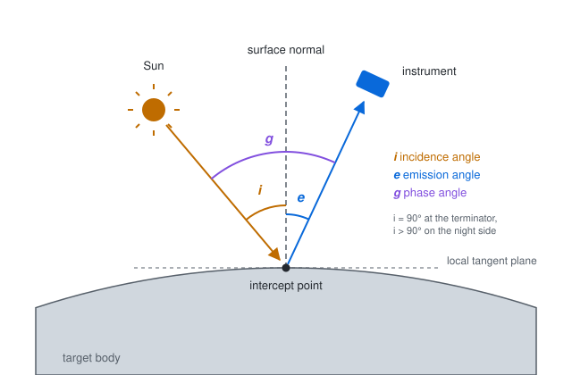
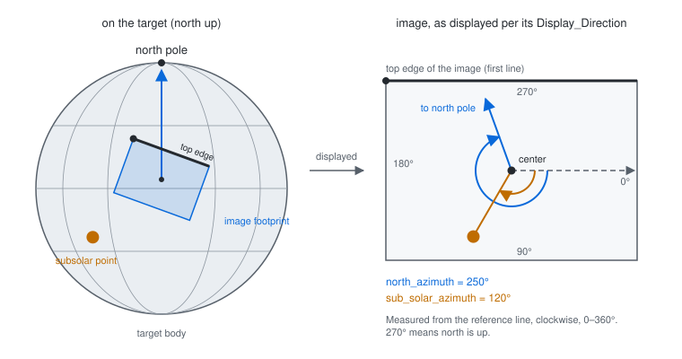
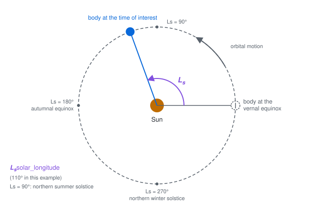

# Solar System Extension Specification

- **Title:** Solar System
- **Identifier:** <https://stac-extensions.github.io/ssys/v1.2.0/schema.json>
- **Field Name Prefix:** ssys
- **Scope:** Item, Catalog, Collection
- **Extension [Maturity Classification](https://github.com/radiantearth/stac-spec/tree/master/README.md#extension-maturity):** Proposal
- **Owner**: @jlaura

This document explains the fields of the STAC Solar System (SSYS) Extension to a STAC Item, Catalog, or Collection.
SSYS covers data sets that represents an individual image, mosaic, or derived raster of a planetary 
body.
Examples of SSYS data include sensors with visible, short-wave and mid-wave IR bands (e.g., the 
THEMIS instrument on Mars Odyssey), visible images (e.g. Context Camera (CTX) aboard Mars Global 
Surveyor), or derived data sets like digital elevation models (DEM/DTM).

- Examples:
- [Catalog Example (Europa Galileo SSI Image)](examples/catalog.json)
- [Collection Example (Europa Galileo SSI Image)](examples/collection.json)
- [Item Example (Europa Galileo SSI Image)](examples/item.json)
- [SSYS JSON Schema](json-schema/schema.json)

## Item Properties

| Field Name      | Type        | Description |
| --------------- | ----------- | ----------- |
| ssys:targets    | \[string\]    | Array to hold list of target bodies (e.g. Mars, Moon, Earth) conforming to the [International Virtual Observatory Alliance](https://www.ivoa.net/documents/EPNTAP/20220822/REC-EPNTAP-2.0.html#tth_sEc2.1.3) target name specification. |
| ssys:local_time  | string      | Lexicographically sortable time string (e.g., 01:115:12.343) |
| ssys:target_class | string | The identity of the type of the target as defined by the [International Virtual Observatory Alliance](https://www.ivoa.net/documents/EPNTAP/20220822/REC-EPNTAP-2.0.html#tth_sEc2.1.3) |
| ssys:north_azimuth | number | The angle between a line from the image center to the north pole and a horizontal reference line from the image center to the middle of the right edge, increasing clockwise, with the image displayed according to its declared display direction. Range: 0-360°. Source: [`geom:north_azimuth`](https://pds.nasa.gov/datastandards/documents/dd/v1/PDS4_PDS_DD_1Q00/ch37s119.html). |
| ssys:solar_longitude | number | The angle between the body-Sun line at the time of interest and the body-Sun line at its vernal equinox, giving a measure of the season on the target body. Range: 0-360°. Source: [`pds:solar_longitude`](https://pds.nasa.gov/datastandards/documents/dd/v1/PDS4_PDS_DD_1Q00/ch05s840.html).
| ssys:local_true_solar_time | number | The local time on a rotating body, equal to 12 h at the subsolar point and increasing by 1 h for every 15° of east longitude away from it, for prograde rotation. Expressed in decimal hours, range 0-24. Source: [`pds:local_true_solar_time`](https://pds.nasa.gov/datastandards/documents/dd/v1/PDS4_PDS_DD_1Q00/ch05s438.html) (PDS4 encodes it as a string). |
| ssys:emission_angle | number | The angle between the surface normal vector at the intercept point and a vector from the intercept point to the spacecraft. It varies from 0° when the spacecraft is viewing the subspacecraft point (nadir viewing) to 90° when the intercept is tangent to the surface of the target body; higher values indicate more oblique viewing. For ring data, values from 90 to 180° indicate viewing on the unlit side, from oblique or edge-on at 90° to the unlit nadir at 180°. Range: 0-180°. Source: [`geom:emission_angle`](https://pds.nasa.gov/datastandards/documents/dd/v1/PDS4_PDS_DD_1Q00/ch37s34.html). |
| ssys:incidence_angle | number | A measure of the lighting condition at the intercept point: the angle between the local vertical at the intercept point (surface) and a vector from the intercept point to the Sun. It varies from 0° when the intercept point coincides with the subsolar point to 90° when the intercept point is at the terminator; values above 90° correspond to the shadowed or dark portion of the target body. Range: 0-180°. Source: [`geom:incidence_angle`](https://pds.nasa.gov/datastandards/documents/dd/v1/PDS4_PDS_DD_1Q00/ch37s48.html). |
| ssys:phase_angle | number | A measure of the relationship between the instrument viewing position and incident illumination (such as solar light). Measured at the target, it is the angle between a vector to the illumination source and a vector to the instrument. If illumination is from behind the instrument, the phase angle is small. Range: 0-180°. Source: [`geom:phase_angle`](https://pds.nasa.gov/datastandards/documents/dd/v1/PDS4_PDS_DD_1Q00/ch37s121.html). |
| ssys:sub_solar_azimuth | number | The angle between the line from the center of an image to the subsolar point on the target and a horizontal reference line (in the image plane) extending from the image center to the middle right edge of the image, increasing clockwise. Range: 0-360°. Source: [`geom:subsolar_azimuth`](https://pds.nasa.gov/datastandards/documents/dd/v1/PDS4_PDS_DD_1Q00/ch37s203.html). |
| ssys:sub_solar_latitude | number | The planetocentric latitude of the subsolar point on the target. Range: -90 to 90°. Source: [`geom:subsolar_latitude`](https://pds.nasa.gov/datastandards/documents/dd/v1/PDS4_PDS_DD_1Q00/ch37s204.html). |
| ssys:sub_solar_longitude | number | The planetocentric longitude of the subsolar point on the target. Range: 0-360°. Source: [`geom:subsolar_longitude`](https://pds.nasa.gov/datastandards/documents/dd/v1/PDS4_PDS_DD_1Q00/ch37s205.html). |
| ssys:sub_spacecraft_latitude | number | The planetocentric latitude of the sub-spacecraft point on the target. Range: -90 to 90°. Source: [`geom:subspacecraft_latitude`](https://pds.nasa.gov/datastandards/documents/dd/v1/PDS4_PDS_DD_1Q00/ch37s207.html). |
| ssys:sub_spacecraft_longitude | number | The planetocentric longitude of the sub-spacecraft point on the target. Range: 0-360°. Source: [`geom:subspacecraft_longitude`](https://pds.nasa.gov/datastandards/documents/dd/v1/PDS4_PDS_DD_1Q00/ch37s208.html). |

The geometry and illumination fields are sourced from the [NASA PDS4 Data Dictionary](https://pds.nasa.gov/datastandards/dictionaries/).

### Additional Field Information

#### ssys:targets

the field `ssys:targets` allows to have one or more targets listed within an array of strings. 
This can happen, for example, if several moons are in the same view. As an example, this scene 
has both of Ganymede and Jupiter in the same image as taken by the NASA mission Cassini 
[PIA02862](https://photojournal.jpl.nasa.gov/catalog/PIA02862).

The extension adopts the best practice from the 
[IVOA](https://www.ivoa.net/documents/EPNTAP/20201027/WD-epntap-2.0-20201027.html#tth_sEc2.1.3) standard. 
For almost all targets, the best practice is to use the official designation of the
 target as defined by [IAU](https://www.iau.org/public/themes/naming/)(e.g., from
 their official naming guide available via the previously linked page or
[here](https://docs.google.com/spreadsheets/d/1CEXGyancLRtHyPW7u0L_JNi0V8aDuIhv/edit#gid=1358030832)). 
This parameter is case sensitive (mixing lower/upper cases) and all values must use
the standard spelling and case; unusual characters (such as intermediate 
spaces) are allowed, except quotes (preferably changed to _ , which is the 
single-character wildcard in TAP queries). Data providers must be aware that 
services which do not use the IAU designations might not be accessible by the 
clients.

If the target is not an IAU named body, extension users can consider using one of the following:
- The Exoplanet Encyclopedia provides a nearly complete list of currently 
known extrasolar planets: [http://exoplanet.eu/](http://exoplanet.eu/index.php).
- Asteroids: Usage is to use preferably name (if it exists) or principal 
designation.
- Calibration targets: Values can relate to existing names in a given archive (e.g., 
the PSA contains values such as bias, checkout, dark, flatfield, internal source…).

#### ssys:local_time

the field `ssys:local_time` allows for API searchable non-UTC time definitions. The time should be 
encoded in a string that is lexicographically sortable. It is unlikley that this time should be 
something like the SpacecraftClockCount or another entry from the PDS metadata as most metadata 
files do not include a local (or local solar time). This field exists to support discovery in a 
time format that is meaningful to the user. Suggested formats are provided below:

| Body | Time String Format       |
| -----| -------------------------|
| Mars | `MarsYear:Sol:LocalTime` |

As a fallback one can consider using the Julian date. This has drawbacks though, as the Julian date
does not account for the day/night cycle in different bodies which is often a factor in selecting data.

#### ssys:target_class

the field `ssys:target_class` identifies the type of the target. Solar System bodies are defined without ambiguity by the couple
target_class and target_name. Values for this class are derived from the 
[International Virtual Observatory Alliance](https://www.ivoa.net/documents/EPNTAP/20220822/REC-EPNTAP-2.0.html#tth_sEc2.1.3)
target description parameter.

Accepted values are:

- asteroid
- dwarf_planet
- planet
- satellite
- comet
- exoplanet
- interplanetary_medium
- sample
- sky
- spacecraft
- spacejunk
- star
- calibration

#### Geometry and illumination angles

The figures below illustrate the angle conventions of the geometry and illumination fields. Definitions and ranges
follow the [NASA PDS4 Data Dictionary](https://pds.nasa.gov/datastandards/dictionaries/).

`ssys:incidence_angle`, `ssys:emission_angle` and `ssys:phase_angle` are measured at the intercept point on the
target surface:



`ssys:north_azimuth` and `ssys:sub_solar_azimuth` give the direction of the north pole and of the subsolar point as
seen in the image, which is generally not oriented north up. They are measured in the image plane, from a horizontal
reference line going from the image center to the middle of the right edge, increasing clockwise. In the example
below, the image footprint is rotated by 20° on the target, so north appears at 250° instead of 270° (north up):



`ssys:solar_longitude` measures the position of the target body along its orbit, from the vernal equinox:



## Contributing

All contributions are subject to the
[STAC Specification Code of Conduct](https://github.com/radiantearth/stac-spec/blob/master/CODE_OF_CONDUCT.md).
For contributions, please follow the
[STAC specification contributing guide](https://github.com/radiantearth/stac-spec/blob/master/CONTRIBUTING.md) Instructions
for running tests are copied here for convenience.

### Running tests

The same checks that run as checks on PR's are part of the repository and can be run locally to verify that changes are valid.
To run tests locally, you'll need `npm`, which is a standard part of any [node.js installation](https://nodejs.org/en/download/).

First you'll need to install everything with npm once. Just navigate to the root of this repository and on 
your command line run:

```bash
npm install
```

Then to check markdown formatting and test the examples against the JSON schema, you can run:

```bash
npm test
```

This will spit out the same texts that you see online, and you can then go and fix your markdown or examples.

If the tests reveal formatting problems with the examples, you can fix them with:

```bash
npm run format-examples
```
